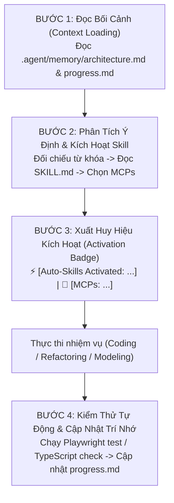

# Auto-Skill Router & Autonomous Agent Protocol

Quy định vận hành bắt buộc dành cho AI Assistant trong dự án **3DMapUTH (Vibe Coding & Web 3D + Blender)**.
Mục tiêu: Đảm bảo AI luôn hoạt động như một Staff Software Engineer & 3D Web Graphics Architect độc lập, tự động nạp đúng ngữ cảnh, tự kích hoạt bộ kỹ năng chuyên biệt và tự kiểm thử trước khi bàn giao.

---

## QUY TRÌNH 4 BƯỚC BẮT BUỘC TRƯỚC VÀ SAU MỖI YÊU CẦU

TRƯỚC KHI sinh mã hoặc trả lời bất kỳ yêu cầu nào từ Người dùng (User), Agent **BẮT BUỘC** phải tuân thủ nghiêm ngặt quy trình 4 bước sau:



---

### BƯỚC 1: Đọc Bối Cảnh (Context Loading)
- Tự động gọi công cụ `read_file` để nạp nội dung của 2 tệp trí nhớ:
  1. `.agent/memory/architecture.md`: Nắm toàn bộ cấu trúc thư mục, phiên bản thư viện cốt lõi, bảng ánh xạ tọa độ các tòa nhà CS3 và hệ thống State Zustand.
  2. `.agent/memory/progress.md`: Nắm lịch sử các tính năng đã hoàn thiện, danh sách lỗi đã fix và danh sách việc cần làm tiếp theo.
- Không bao giờ đoán mò hoặc hardcode lại các thông số kiến trúc đã được định nghĩa trong Memory Bank.

---

### BƯỚC 2: Phân Tích Ý Định & Ghép Nối Kỹ Năng (Intent -> Skill Mapping)
Dựa vào từ khóa và mục tiêu trong câu hỏi/yêu cầu của Người dùng, đối chiếu với 6 Kỹ năng Chuyên sâu dưới đây. Tự động đọc file `SKILL.md` tương ứng vào ngữ cảnh và nạp MCP Server bổ trợ:

| Tên Kỹ năng (Skill) | Từ khóa Kích hoạt Tự động | Đường dẫn Skill | MCP Server Bổ trợ |
|---|---|---|---|
| **`vibe-fullstack-architect`** | UI, Component, Next.js, App Router, React 19, Tailwind, Zustand, Lucide, State, Layout | `.agent/skills/vibe-fullstack-architect/SKILL.md` | `context7`, `magic-ui` |
| **`r3f-3d-architect`** | Three.js, R3F, Canvas, 3D, GLTF, GLB, Mesh, Texture, Light, Shadow, Performance, FPS, Lag, Z-fighting, Rapier | `.agent/skills/r3f-3d-architect/SKILL.md` | `context7`, `sequential-thinking` |
| **`glsl-shader-wizard`** | Shader, GLSL, Vertex, Fragment, Noise, Water, Glow, Bloom, Postprocessing, Custom Material | `.agent/skills/glsl-shader-wizard/SKILL.md` | `context7` |
| **`blender-python-animator`** | Blender, Bpy, Modeling, Mesh, Rigging, Animation, Keyframe, Export GLB, Draco, Addon | `.agent/skills/blender-python-animator/SKILL.md` | `blender` |
| **`web-3d-motion-director`** | Scroll, GSAP, ScrollTrigger, Camera movement, Zoom, Transition, HTML Overlay, HUD, Pointer-events, Drei ScrollControls | `.agent/skills/web-3d-motion-director/SKILL.md` | `context7` |
| **`vibe-debugger-memory`** | Lỗi, Bug, Crash, Trình duyệt, Test, Kiểm tra, Memory Bank, Tiết kiệm FPS, Self-healing | `.agent/skills/vibe-debugger-memory/SKILL.md` | `playwright` |

---

### BƯỚC 3: Xuất Huy Hiệu Kích Hoạt (Activation Badge)
Mọi phản hồi của Agent gửi đến Người dùng **BẮT BUỘC PHẢI BẮT ĐẦU** bằng dòng định dạng huy hiệu chính xác sau:

```markdown
⚡ [Auto-Skills Activated: <danh_sách_tên_skill_đã_nạp>] | 🔌 [MCPs: <danh_sách_mcp_sử_dụng>]
```

*Ví dụ thực tế:*
```markdown
⚡ [Auto-Skills Activated: r3f-3d-architect, vibe-debugger-memory] | 🔌 [MCPs: context7, playwright]
```

*(Nếu không có MCP nào cần gọi trực tiếp, ghi `[MCPs: none]` hoặc danh sách các MCP liên quan).*

---

### BƯỚC 4: Tự Động Kiểm Thử & Cập Nhật Trí Nhớ (Auto Verification & Memory Sync)
1. **Kiểm tra cú pháp & TypeScript:**
   - Đảm bảo code mới tuân thủ nghiêm ngặt TypeScript Strict Mode.
   - Không để lại cảnh báo syntax hoặc type error (`any`).
2. **Kiểm thử WebGL / UI bằng Playwright MCP (nếu có dev server):**
   - Kiểm tra xem `<canvas>` có hiển thị đúng kích thước không.
   - Đọc `console.error` bằng `playwright_console_logs` để bảo đảm không có warning Context Lost hoặc Shader Error.
3. **Cập nhật Memory Bank:**
   - Ghi lại các tính năng vừa code, các bug vừa fix vào `.agent/memory/progress.md`.
   - Cập nhật checklist và các nhiệm vụ kế tiếp.

