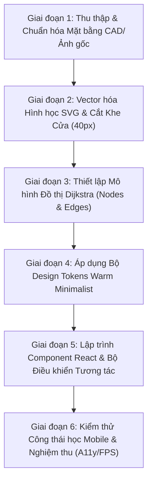

# UTH 2D Wayfinding Design System & UI/UX Standards
**Hệ thống Quy chuẩn Thiết kế UI/UX & Bản đồ Dẫn đường 2D UTH (Chuẩn Tòa K)**

Tài liệu và skill này chuẩn hóa toàn bộ quy trình thiết kế, lập trình và nghiệm thu giao diện bản đồ 2D cho toàn bộ các tòa nhà thuộc Đại học Giao thông vận tải TP.HCM (UTH).

---

## 1. TỔNG QUAN MỤC TIÊU & PHẠM VI (OVERVIEW & SCOPE)

- **Mục tiêu:** Cung cấp bộ quy chuẩn duy nhất (Single Source of Truth) về Design Tokens, Components, Interactions, và Workflow để đội ngũ Frontend Developer, Designer và AI Agent xây dựng các bản đồ 2D trong nhà (Indoor Map) nhanh chóng, đồng nhất và không xảy ra xung đột giao diện trên di động.
- **Phạm vi áp dụng:** Toàn bộ bản đồ mặt bằng các tòa nhà (Tòa K, Tòa B, Tòa A, Tòa C, Tòa E, Tòa H, Tòa I) tại Cơ sở 1 và Cơ sở 3 UTH.
- **Đối tượng sử dụng:** Frontend Developers (React/Next.js/Tailwind), UI/UX Designers (Figma/Sketch), AI Agents (Antigravity/Cursor/Copilot).
- **Tech Stack chuẩn:**
  - Framework: React 19, Next.js App Router (Client Components).
  - Ngôn ngữ: TypeScript (Strict Mode, 100% zero `any`).
  - Styling: Tailwind CSS v3/v4 (Utility-first, CSS variables).
  - Vector Graphics: Scalable Vector Graphics (SVG) hệ tọa độ thực.
  - Icons: `lucide-react` (bắt buộc `strokeWidth={1.5}`) + SVG Custom Symbols (Bậc thang, ISO WC).

---

## 2. QUY TRÌNH THIẾT KẾ & TRIỂN KHAI UI/UX (6-PHASE PIPELINE)

Mọi bản đồ 2D mới đều phải trải qua 6 bước nghiêm ngặt sau:

1. **Giai đoạn 1 (Input Analysis):** Rà soát ảnh mặt bằng thực tế, định danh mã phòng (VD: B.001, K.301), xác định vị trí lõi giao thông đứng (Cầu thang, Thang máy), tiện ích (WC Nam/Nữ), hướng thoát hiểm và cửa ra vào.
2. **Giai đoạn 2 (SVG Geometry Vectorization):** Lập viewBox chuẩn ($3:4$ cho khổ dọc, hoặc $2:1$ cho khổ ngang). Đục khoét các khe hở cửa ra vào ($40\text{px}$) trên tường bao, không vẽ tường kín bít bùng.
3. **Giai đoạn 3 (Graph Engine):** Khởi tạo danh sách Nodes (phòng, cửa, ngã rẽ hành lang, cầu thang) và Edges liên kết để thuật toán Dijkstra tự động tính toán lộ trình ngắn nhất.
4. **Giai đoạn 4 (Token Binding):** Nạp chính xác mã màu HEX quy chuẩn, font chữ `Plus Jakarta Sans`, các đường vân bậc tam cấp và icon ISO.
5. **Giai đoạn 5 (Frontend Assembly):** Đóng gói thành Component React hỗ trợ Pan & Zoom, Search Box gợi ý phòng, Bottom Drawer chỉ dẫn từng bước có thể thu gọn.
6. **Giai đoạn 6 (Quality Gate):** Kiểm tra hiển thị trên thiết bị di động (tối thiểu màn hình 375px), bảo đảm không có nút bấm bị cắt mép hay chồng chéo (Zero UI Collision), đạt chuẩn 60 FPS.

---

## 3. BẢNG MÃ ĐẶC TẢ GIAO DIỆN & DESIGN TOKENS

### 3.1. Bảng màu Kiến trúc Tối Giản Tông Ấm (Warm Minimalist Palette)

| Mã Token | Giá trị HEX | Tên gọi | Ứng dụng cụ thể trong bản đồ |
| :--- | :---: | :--- | :--- |
| `bg-corridor` | `#F3EFEA` | Warm Cream | Nền của toàn bộ hành lang và lối đi lưu thông |
| `border-wall` | `#4A4540` | Charcoal Warm Gray | Viền tường bê tông ngăn phòng (độ dày $3.5\text{px} - 4\text{px}$) |
| `room-primary` | `#FAF2E6` | Warm Ivory | Phòng học chính, phòng thi, phòng hội trường |
| `room-secondary`| `#C8BEB3` | Muted Warm Taupe | Phòng học phụ, phòng lab thực hành |
| `room-office` | `#CDB07A` | Warm Mustard Gold | Văn phòng Khoa, Viện, Tạp chí, Phòng Quản lý |
| `stair-bg` | `#605B55` | Charcoal Slate | Nền khối cầu thang bộ |
| `stair-stripe` | `#48443F` | Dark Charcoal Stripes| Vân sọc mô phỏng các bậc tam cấp |
| `wc-bg` | `#B5C2C9` | Muted Steel Blue | Khu vực nhà vệ sinh (WC Nam / Nữ) |
| `route-teal` | `#0F4C5C` | Deep Teal (Cổ vịt) | Tuyến đường dẫn lối chính, Mũi tên định hướng, Avatar Pin |
| `route-sub` | `#E8F2F4` | Soft Teal Tint | Nền badge khoảng cách bước chân |
| `text-dark` | `#1A1817` | Neutral Deep Black | Chữ số phòng, tên phòng trên nền sáng |
| `text-light` | `#FFFFFF` | Pure White | Chữ số và icon trên nền cầu thang, WC, hoặc badge |

### 3.2. Quy chuẩn Typography (Kiểu chữ & Phân cấp)
- **Font Family:** `font-sans` ưu tiên `Plus Jakarta Sans`, `Inter`, `system-ui, -apple-system, sans-serif`.
- **Tên/Số phòng (Room Codes):** Font size $18\text{px} - 24\text{px}$, Font weight `700` hoặc `800`, căn giữa phòng (`text-anchor="middle"`).
- **Mô tả phòng phụ (Sub-labels):** Font size $11\text{px} - 13\text{px}$, Font weight `600`, Uppercase hoặc Title Case.
- **Tên cầu thang / WC:** Font size $14\text{px} - 16\text{px}$, Font weight `700`, màu trắng `#FFFFFF` trên nền tối.
- **Badge thông tin:** Font size $9\text{px} - 10\text{px}$, Font weight `800`, font-mono hoặc sans-serif.

### 3.3. Quy chuẩn Khe Cửa (Door Openings) & Bậc Thang
- **Cửa ra vào (Door Cuts):** Chiều rộng khoảng hở tường chuẩn là $36\text{px} - 40\text{px}$.
- **Cung quay cánh cửa (Door Swing Arc):** Vẽ đường tròn cong bán nguyệt nét đứt (`stroke-dasharray="3,3"` màu `#7A736B`) nối từ mép cửa để phân biệt cửa mở trong hay mở ngoài.
- **Vân bậc cầu thang:** Pattern lặp lại các đường sọc song song dày $2.5\text{px} - 3.5\text{px}$, bước $6\text{px} - 8\text{px}$ màu `#48443F`.
- **Icon bậc thang:** Biểu tượng zigzag 4 bậc gấp khúc màu trắng (`strokeWidth="3"` hoặc `"4"`).

---

## 4. DANH MỤC THÀNH PHẦN (COMPONENT INVENTORY & SPECS)

### 4.1. `MapContainer` (Khung bao SVG)
- **Props:** `zoom: number`, `pan: { x: number, y: number }`, `isDragging: boolean`.
- **Cơ chế:** Co giãn tự động trong khung thẻ Card bo góc `rounded-xl`, nền ngoài `#4A4540` tạo cảm giác bản vẽ kiến trúc đặt trên bàn làm việc sang trọng.

### 4.2. `RoomBlock` (Khối Phòng Học)
- **States:** `default`, `hover`, `selected`.
- **Tương tác:** Bấm vào phòng lập tức highlight viền nét đứt màu Deep Teal (`#0F4C5C`) và mở thẻ thông tin dưới đáy.

### 4.3. `RoutePath` & `AvatarPin` (Đường Dẫn & Vị Trí Người Dùng)
- **Đường dẫn:** Tuyến đường nét đậm $3.5\text{px}$, `stroke-linecap="round"`, `stroke-linejoin="round"`.
- **Mũi tên định hướng:** Các tam giác đều gắn tại mỗi đoạn đổi hướng chỉ rõ chiều rẽ (Đông `►`, Bắc `▲`, Tây `◄`, Nam `▼`).
- **Avatar Pin:** Hình giọt nước (Teardrop Pin) ngược màu Deep Teal (`#0F4C5C`), viền trắng $1.5\text{px}$, bên trong chứa hình nhân thu nhỏ màu trắng và vòng hào quang mờ ($15\%$ opacity).

### 4.4. `StepBottomSheet` (Ngăn Kéo Chỉ Dẫn Dưới Đáy)
- **States:** `collapsed` (Mini-bar $44\text{px}$) hoặc `expanded` (Hiện toàn bộ danh sách bước đi).
- **Tính năng bắt buộc:** Nút gạt thu gọn chạm 1-chạm để không bao giờ chiếm dụng quá $15\%$ chiều cao màn hình điện thoại khi người dùng cần quan sát bản đồ.

---

## 5. BỐ CỤC & RESPONSIVE BREAKPOINTS (MOBILE-FIRST)

| Kích thước | Breakpoint | Định dạng bố cục | Yêu cầu công thái học |
| :--- | :---: | :--- | :--- |
| **Mobile Nhỏ** | $<480\text{px}$ | Khổ dọc $3:4$ hoặc $9:16$ | Toàn bộ cụm phím chức năng ngang $\le 340\text{px}$, ngăn kéo đáy thu gọn được còn $44\text{px}$. |
| **Tablet** | $640\text{px} - 1024\text{px}$ | Khung căn giữa màn hình ($88\text{vw}$) | Hỗ trợ Pinch-to-zoom 2 ngón tay và vuốt Pan 1 ngón tay mượt mà. |
| **Desktop / 4K** | $>1024\text{px}$ | Khung bản vẽ tối đa $1200\text{px}$ | Lăn chuột phóng to/thu nhỏ, click chuột kéo thả, phím Reset góc nhìn $100\%$. |

---

## 6. QUY TẮC ĐẶT TÊN & TỔ CHỨC FILE (NAMING CONVENTIONS)

- **File Dữ liệu Tòa nhà:** `src/data/building<TênTòa>2dData.ts` (VD: `buildingK2dData.ts`, `buildingB2dData.ts`).
- **Component Điều hướng 2D:** `src/components/navigation2d/Building<TênTòa>2DNavigator.tsx` (VD: `BuildingB2DNavigator.tsx`, `WarmMinimalist2DNavigator.tsx`).
- **File HTML Độc lập:** `public/navigation-<tên-tòa>-2d.html` (VD: `navigation-toab-2d.html`).
- **Tài liệu Đặc tả Kiến trúc:** `dac_ta_giao_dien_ban_do_2d_<tên-tòa>.md`.

---

## 7. CHECKLIST NGHIỆM THU CHẤT LƯỢNG (QUALITY GATE CRITERIA)

Mỗi bản đồ 2D trước khi đưa vào sản xuất phải vượt qua $100\%$ các bài kiểm tra sau:

- [ ] **1. Tỷ lệ hình học:** Bản vẽ chuẩn tỷ lệ thực, không bị méo lệch tọa độ.
- [ ] **2. Khe cửa ra vào:** Các phòng đều có khe hở cửa $36-40\text{px}$ dẫn ra hành lang, có cung mở cửa quay.
- [ ] **3. Bảng màu quy chuẩn:** Sử dụng chính xác bảng màu HEX của hệ thống Tòa K, không tự tiện dùng màu sặc sỡ.
- [ ] **4. Icon cầu thang & WC:** Đầy đủ vân sọc bậc tam cấp và ký hiệu ISO chuẩn.
- [ ] **5. Mũi tên dẫn đường:** Mũi tên chỉ đúng hướng di chuyển tại các đoạn rẽ.
- [ ] **6. Không chồng chéo trên Mobile:** Header phân tầng khoa học, thanh tìm kiếm và phím chức năng không đè lấp bản đồ.
- [ ] **7. Ngăn kéo thu gọn:** Thẻ đáy có thể thu gọn mượt mà về dạng mini-bar.
- [ ] **8. Độ tương phản tiếp cận (A11y):** Tỷ lệ tương phản chữ trên nền đạt tối thiểu $4.5:1$ (WCAG AA).
- [ ] **9. Hiệu năng hiển thị:** Vận hành trơn tru đạt mức 60 FPS khi Pan và Zoom.
- [ ] **10. Kiểm thử TypeScript:** `npx tsc --noEmit` hoàn thành với 0 lỗi.
