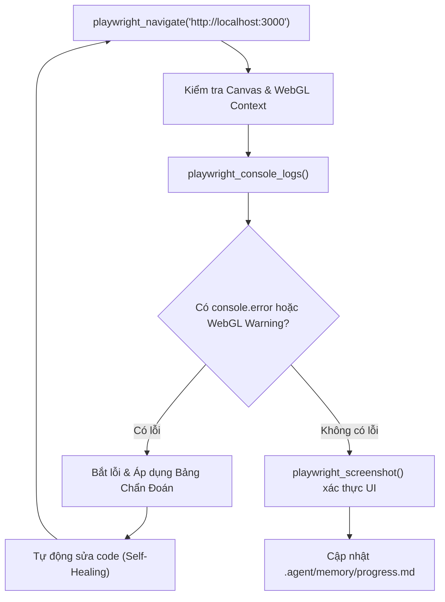

# Vibe Debugger & Memory Bank Skill

Kỹ năng tự động quản lý trạng thái dự án (Memory Bank), tự động kiểm thử trình duyệt nội bộ bằng Playwright MCP, chẩn đoán lỗi WebGL/React 19 và thực thi vòng lặp tự phục hồi lỗi (Self-Healing Debugging Loop).

---

## 1. Quy trình Đọc & Ghi Memory Bank

Hệ thống Trí nhớ Dự án (Project Memory Bank) gồm 2 file cốt lõi trong `.agent/memory/`:
1. `.agent/memory/architecture.md`: Bản đồ kiến trúc, Tech Stack, quy chuẩn tọa độ 3D và danh sách tài nguyên (.glb).
2. `.agent/memory/progress.md`: Nhật ký tiến độ, các tính năng hoàn thành, lỗi đã xử lý và việc cần làm tiếp theo.

### Giai đoạn 1: Bắt đầu Nhiệm vụ (Input Phase)
Trước khi đưa ra giải pháp hoặc viết code:
- Đọc file `.agent/memory/architecture.md` để nắm rõ cấu trúc thư mục, phiên bản thư viện và bảng tọa độ các tòa nhà.
- Đọc file `.agent/memory/progress.md` để biết nhiệm vụ trước đó đã dừng ở đâu, tránh làm lại hoặc xung đột logic cũ.

### Giai đoạn 2: Kết thúc Nhiệm vụ (Output Phase)
Sau khi code và chạy test thành công:
- Mở `.agent/memory/progress.md`.
- Thêm một mục mới vào phần **Tính năng & Sửa lỗi vừa hoàn thành** với thời gian, mô tả ngắn gọn và file bị thay đổi.
- Đánh dấu hoàn thành các việc trong checklist và cập nhật các bước tiếp theo.

---

## 2. Quy trình Tự Động Kiểm Thử Bằng Playwright MCP

Khi môi trường web dev đang chạy (ví dụ `http://localhost:3000`), tự động thực hiện chu kỳ kiểm tra sau:



### Các bước gọi công cụ Playwright:
1. **Khởi hướng tới ứng dụng:**
   - Sử dụng `call_mcp_tool` với server `playwright` và công cụ `playwright_navigate`:
     `{ url: "http://localhost:3000" }`
2. **Kiểm tra trạng thái Canvas 3D:**
   - Dùng `playwright_evaluate` để kiểm tra canvas tồn tại và có kích thước hiển thị:
     ```javascript
     () => {
       const canvas = document.querySelector('canvas');
       if (!canvas) return { error: 'Không tìm thấy thẻ <canvas> trong DOM' };
       const rect = canvas.getBoundingClientRect();
       return {
         exists: true,
         width: rect.width,
         height: rect.height,
         webgl2: !!canvas.getContext('webgl2'),
       };
     }
     ```
3. **Đọc toàn bộ Log & Bắt lỗi:**
   - Gọi `playwright_console_logs` để thu thập các lỗi runtime, React 19 hydration mismatch, shader compilation errors, hoặc HTTP 404 khi tải model `.glb`.
4. **Chụp ảnh màn hình kiểm chứng trực quan:**
   - Gọi `playwright_screenshot` để xác minh không còn hiện tượng rách hình, Z-Fighting hoặc lệch bố cục.

---

## 3. Bảng Chẩn Đoán Lỗi WebGL / Three.js Phổ Biến & Cách Khắc Phục

| Triệu chứng / Thông báo lỗi | Nguyên nhân gốc rễ | Giải pháp Tự Phục Hồi (Self-Healing) |
|---|---|---|
| **`THREE.WebGLState: Context Lost`** | Tràn bộ nhớ GPU (VRAM) do texture 4K/8K quá nặng hoặc tạo quá nhiều Renderer | 1. Nén texture sang KTX2/WebP.<br>2. Chạy `geometry.dispose()` và `material.dispose()`.<br>3. Kiểm tra không tạo nhiều hơn 1 component `<Canvas>`. |
| **`Cannot read property of undefined (reading 'traverse')`** | Gọi thao tác trên object trước khi `useGLTF` hoặc loader tải xong | 1. Bọc component chứa model trong `<Suspense fallback={null}>`.<br>2. Thêm guard clause: `if (!scene) return null;`. |
| **`R3F: Hooks can only be used within the Canvas component!`** | Đặt hook 3D (`useThree`, `useFrame`, `useGLTF`) ở component cha bên ngoài `<Canvas>` | Di chuyển component chứa hook vào bên trong khối `<Canvas>...</Canvas>`. |
| **Nhấp nháy bề mặt (Z-Fighting)** | 2 mặt phẳng (như mặt đường và sân bóng) có cùng tọa độ Y | 1. Tăng khoảng cách trục Y lên `0.05` đến `0.1` đơn vị.<br>2. Điều chỉnh tỉ lệ camera: `near = 0.5`, `far = 1000` (giảm khoảng cách giữa near và far). |
| **Drop FPS định kỳ mỗi 3-5 giây** | Garbage Collection (GC) giật cục do cấp phát bộ nhớ liên tục trong `useFrame` | Loại bỏ toàn bộ `new THREE.Vector3()`, `new THREE.Matrix4()`, `new THREE.Color()` ra khỏi `useFrame`. Sử dụng static vector tái sử dụng. |
| **Mô hình bị đen thui hoàn toàn** | Thiếu ánh sáng môi trường hoặc normals bị đảo ngược | Thêm `<ambientLight intensity={0.7} />` hoặc `<Environment preset="city" />`. |
| **Lỗi tải file 404 `.glb` trong Next.js** | Đặt sai đường dẫn trong thư mục `public` | Đảm bảo file nằm trong `public/models/...` và gọi với URL tuyệt đối `/models/...` (không dùng relative path `./public`). |

---

## 4. Mẫu Đoạn Mã Tự Phục Hồi (Self-Healing Code Pattern)

Khi gặp lỗi model chưa sẵn sàng hoặc bị null trong render loop, luôn bọc bảo vệ theo mẫu sau:

```tsx
// src/components/canvas/SafeBuildingRenderer.tsx
'use client';

import React, { Suspense, useRef } from 'react';
import { useGLTF } from '@react-three/drei';
import { Group } from 'three';

interface SafeBuildingProps {
  url: string;
  position: [number, number, number];
  rotation?: [number, number, number];
  scale?: [number, number, number] | number;
}

function BuildingModel({ url, position, rotation = [0, 0, 0], scale = 1 }: SafeBuildingProps) {
  // Tải an toàn với useGLTF
  const { scene } = useGLTF(url);
  const groupRef = useRef<Group>(null);

  // Guard clause bảo vệ chống crash
  if (!scene) return null;

  return (
    <group ref={groupRef} position={position} rotation={rotation} scale={scale}>
      <primitive object={scene.clone()} frustumCulled={true} />
    </group>
  );
}

// Bọc ngoài với ErrorBoundary và Suspense
export function SafeBuilding(props: SafeBuildingProps) {
  return (
    <Suspense fallback={null}>
      <BuildingModel {...props} />
    </Suspense>
  );
}
```

---

## 5. Tiêu Chuẩn Hoàn Thành (Definition of Done)
1. Đã đọc Memory Bank ở bước đầu tiên.
2. Không còn bất kỳ cảnh báo hoặc lỗi nào trong `console.error`.
3. Kiểm tra bằng Playwright: Canvas render đúng tỷ lệ, không giật lag (đạt 60 FPS).
4. Đã cập nhật kết quả vào `.agent/memory/progress.md`.

