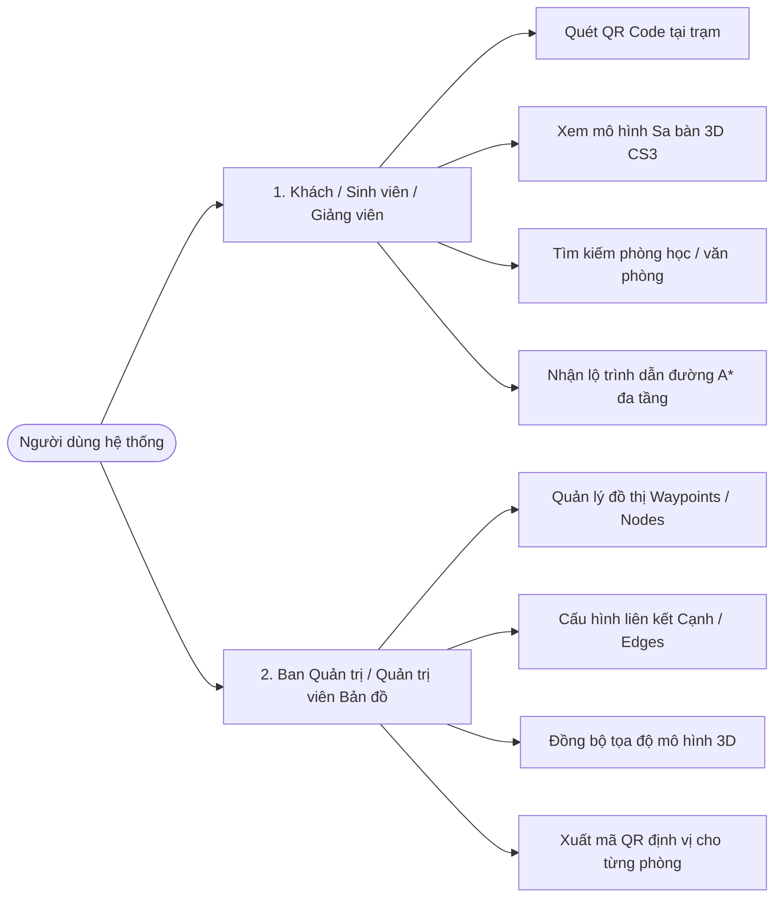
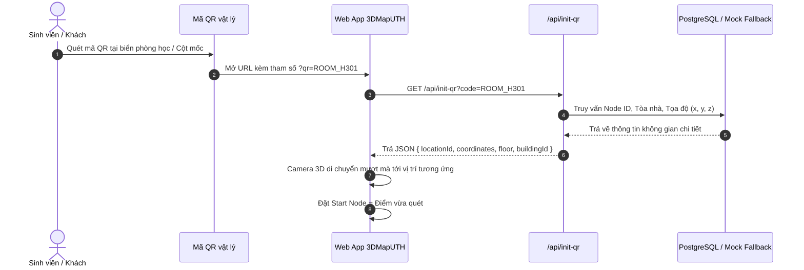
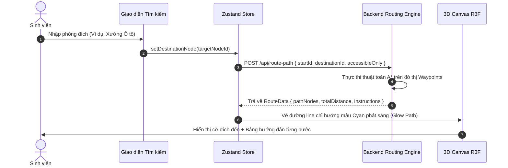
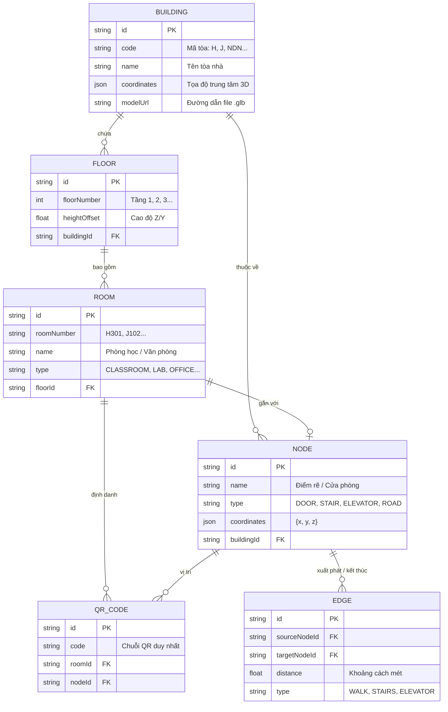

# BÁO CÁO TOÀN DIỆN PHÂN TÍCH DỰ ÁN 3DMAPUTH

**Hệ thống Bản đồ Số 3D & Dẫn đường Tương tác Trường Đại học Giao thông vận tải TP.HCM (Cơ sở 3)**

---

## MỤC LỤC

1. [Phân tích Đề tài & Yêu cầu Nghiệp vụ (Project Scope & Domain)](#1-phân-tích-đề-tài--yêu-cầu-nghiệp-vụ)
   - [1.1. Mục tiêu cốt lõi](#11-mục-tiêu-cốt-lõi)
   - [1.2. Đối tượng sử dụng (Actors & Roles)](#12-đối-tượng-sử-dụng-actors--roles)
   - [1.3. Các luồng nghiệp vụ chính (Business Flows)](#13-các-luồng-nghiệp-vụ-chính-business-flows)
2. [Phân tích Công nghệ & Kiến trúc Hệ thống (Tech Stack & Architecture)](#2-phân-tích-công-nghệ--kiến-trúc-hệ-thống)
   - [2.1. Frontend & Không gian 3D WebGL](#21-frontend--không-gian-3d-webgl)
   - [2.2. Backend & Chuẩn giao tiếp API](#22-backend--chuẩn-giao-tiếp-api)
   - [2.3. Cơ sở dữ liệu & Mô hình quan hệ (Prisma ERD)](#23-cơ-sở-dữ-liệu--mô-hình-quan-hệ)
   - [2.4. Hạ tầng, Quy trình Tối ưu hóa Model 3D & DevOps](#24-hạ-tầng--pipeline-tối-ưu-hóa-3d)
3. [Đánh giá Tiến độ & Hiện trạng Dự án (Current Status & Progress)](#3-đánh-giá-tiến-độ--hiện-trạng-dự-án)
   - [3.1. Phân loại Module hoàn thiện vs Đang phát triển](#31-phân-loại-module)
   - [3.2. Ước tính tiến độ tổng thể](#32-ước-tính-tiến-độ-tổng-thể)
   - [3.3. Đề xuất kế hoạch hành động tiếp theo (Next Steps)](#33-kế-hoạch-hành-động-tiếp-theo)
4. [Phụ lục Kỹ thuật (Technical Appendices)](#4-phụ-lục-kỹ-thuật)
   - [4.1. Bảng tọa độ quy hoạch không gian các khối nhà CS3](#41-bảng-tọa-độ-quy-hoạch)
   - [4.2. Danh mục tài nguyên mô hình 3D tối ưu](#42-danh-mục-tài-nguyên-mô-hình-3d)
   - [4.3. Bảng tra cứu tập lệnh quản trị dự án](#43-bảng-tra-cứu-tập-lệnh)

---

## 1. PHÂN TÍCH ĐỀ TÀI & YÊU CẦU NGHIỆP VỤ

### 1.1. Mục tiêu cốt lõi

Dự án **3DMapUTH** giải quyết bài toán định vị không gian và điều hướng thông minh (Indoor & Outdoor Navigation) trong khuôn viên trường đại học hiện đại, cụ thể áp dụng tại **Cơ sở 3 - Trường Đại học Giao thông Vận tải TP.HCM (UTH)**.

#### Các bài toán thực tế được giải quyết

- **Xóa bỏ tình trạng thất lạc phòng học/khu chức năng:** Khuôn viên trường rộng lớn với nhiều tòa nhà (Tòa H, J, Nhà Đa Năng, Nhà I, Xưởng Ô tô...), gây khó khăn cho tân sinh viên, giảng viên thỉnh giảng và khách tham quan.
- **Dẫn đường liên tòa nhà và đa tầng (Multi-floor & Cross-building Navigation):** Không chỉ dẫn đường trên mặt phẳng 2D như Google Maps, hệ thống tính toán tuyến đường 3D xuyên suốt từ cổng trường $\rightarrow$ sân đường $\rightarrow$ sảnh tòa nhà $\rightarrow$ thang máy/thang bộ $\rightarrow$ cửa phòng học cụ thể.
- **Trải nghiệm trực quan hóa số (Digital Twin Campus):** Cung cấp mô hình sa bàn 3D tương tác theo thời gian thực trực tiếp trên trình duyệt Web (máy tính lẫn smartphone) mà không yêu cầu cài đặt ứng dụng native.

---

### 1.2. Đối tượng sử dụng (Actors & Roles)



1. **Khách vãng lai / Sinh viên / Giảng viên (End Users):**
   - Truy cập nhanh qua quét mã QR dán tại các trạm thông tin, bảng hiệu phòng hoặc bảng chỉ dẫn sân trường.
   - Định vị tức thời điểm đang đứng (Current Location).
   - Tìm kiếm phòng theo mã phòng (ví dụ: `H301`, `J102`), tên phòng ban, tiện ích (căn tin, nhà vệ sinh, ATM).
   - Xem lộ trình di chuyển 3D với hướng dẫn rẽ từng bước (Turn-by-turn guidance).

2. **Quản trị viên Hệ thống (System Administrators / Map Editors):**
   - Quản lý danh mục Tòa nhà (`Building`), Tầng (`Floor`), Phòng (`Room`).
   - Biên tập đồ thị điều hướng (Node/Waypoints và Edges) thông qua giao diện trực quan Map Editor.
   - Tạo và in ấn mã định danh QR Code cho toàn bộ cơ sở vật chất.

---

### 1.3. Các luồng nghiệp vụ chính (Business Flows)

#### A. Luồng Định vị tức thời qua QR Code (`/api/init-qr`)



#### B. Luồng Tìm kiếm & Tạo lộ trình chỉ đường A* (`/api/route-path`)



---

## 2. PHÂN TÍCH CÔNG NGHỆ & KIẾN TRÚC HỆ THỐNG

### 2.1. Frontend & Không gian 3D WebGL

- **Framework nền tảng:** [Next.js](https://nextjs.org/) (phiên bản 16 hiện đại nhất), [React](https://react.dev/) 19, TypeScript nghiêm ngặt (Strict mode).
- **Đồ họa Không gian 3D:**
  - `Three.js` (r186) kết hợp thư viện bao bọc hướng khai báo `@react-three/fiber` (R3F) và `@react-three/drei`.
  - Cơ chế tải mô hình bất đồng bộ với `useGLTF` và bộ đệm (caching).
  - Hệ thống ánh sáng vật lý PBR: `ambientLight`, `directionalLight` đổ bóng mềm, bầu trời động (`Sky`), mặt sương mù (`fog`) tăng chiều sâu không gian.
- **Quản lý trạng thái (State Management):**
  - [Zustand](https://zustand-demo.pmnd.rs/): Sử dụng trong `src/store/useNavigationStore.ts` để lưu trữ trạng thái đơn lập, phản ứng cực nhanh không gây giật lag canvas 3D.
- **Giao diện & Trải nghiệm (UI/UX):**
  - [Tailwind CSS](https://tailwindcss.com/): Thiết kế giao diện Glassmorphism hiện đại, responsive hoàn toàn trên Mobile và Desktop.
  - [Lucide React](https://lucide.dev/): Hệ thống icon đồng bộ chuẩn nét thanh mảnh (`strokeWidth={1.5}`).

---

### 2.2. Backend & Chuẩn giao tiếp API

- **Kiến trúc:** Next.js Route Handlers (Edge & Node.js Runtime Serverless Handlers).
- **Chuẩn giao tiếp:** RESTful API chuẩn đầu ra `application/json`.
- **Cơ chế dự phòng Zero-Downtime Fallback:**
  - Tích hợp khối `try / catch` toàn diện: Khi cơ sở dữ liệu PostgreSQL chưa kích hoạt hoặc gặp sự cố mạng, API tự động fallback sang `mockNavigationData.ts`, bảo đảm ứng dụng **không bao giờ bị gián đoạn hay đổ sập**.

```
[Client / Mobile] 
       │
       ▼
[Next.js App Router API Handlers] 
       │
       ├──► Có DB: Prisma Client ──► [PostgreSQL Database]
       └──► Mất DB: Fallback Data Provider ──► [In-Memory Mock Graph]
```

---

### 2.3. Cơ sở dữ liệu & Mô hình quan hệ

Cơ sở dữ liệu được định nghĩa chi tiết trong `prisma/schema.prisma`:



---

### 2.4. Hạ tầng, Pipeline Tối ưu hóa 3D & DevOps

#### Pipeline tối ưu hóa mô hình 3D (Asset Optimization Pipeline)

Để giải quyết triệt để vấn đề giật lag khi tải mô hình 3D qua mạng 4G/di động, dự án trang bị pipeline nén tự động qua script:
`node scripts/optimize-models.mjs`

| Tòa nhà / Khu vực | File gốc (MB) | File tối ưu (MB) | Tỷ lệ giảm |
| :--- | :---: | :---: | :---: |
| **Nhà Đa Năng** | 53.0 MB | **3.85 MB** | **-92.7%** |
| **Tòa H** | 56.6 MB | **4.21 MB** | **-92.6%** |
| **Xưởng Ô Tô** | 39.0 MB | **3.12 MB** | **-92.0%** |
| **Tòa J** | 46.2 MB | **3.44 MB** | **-92.5%** |
| **Nhà I (Khu phụ trợ)** | 39.0 MB | **3.18 MB** | **-91.8%** |
| **TỔNG KHUÔN VIÊN** | **233.8 MB** | **17.80 MB** | **-92.4%** |

*Công nghệ nén áp dụng:* Google Draco Compression, nén mesh geometry, tối ưu Texture MIP maps và gom vật liệu PBR.

---

## 3. ĐÁNH GIÁ TIẾN ĐỘ & HIỆN TRẠNG DỰ ÁN

### 3.1. Phân loại Module

| Module chức năng | Tình trạng | Chi tiết kỹ thuật |
| :--- | :---: | :--- |
| **3D Canvas & Scene CS3** | ✅ 100% | Render hoàn chỉnh bản đồ CS3, ánh sáng, bóng đổ, thảm cỏ, hệ thống đường giao thông. |
| **Tích hợp Model 3D CS3** | ✅ 100% | Đã nén và tích hợp 5 khối nhà trọng điểm vào đúng tọa độ thực tế. |
| **Quản lý State (Zustand)** | ✅ 100% | Quản lý điểm đi, điểm đến, camera view, step navigation đầy đủ. |
| **REST API Init & Route** | ✅ 90% | Xong endpoint `/api/init-qr` và `/api/route-path`, có fallback mượt mà. |
| **Thuật toán Tìm đường A\*** | ✅ 85% | Đã chạy tốt trên tập Waypoints mẫu, cần mở rộng mạng lưới node toàn trường. |
| **Cơ sở dữ liệu PostgreSQL** | 🟡 70% | Schema Prisma chuẩn chỉnh, đang chờ kết nối Database Cloud thực tế. |
| **Admin Map Editor** | 🟡 60% | Đã dựng giao diện công cụ tại `/admin/map-editor`, cần hoàn thiện lưu xuống DB. |
| **Authentication (RBAC)** | 🔴 20% | Chưa có module phân quyền bảo vệ tuyến `/admin`. |
| **GPS Geolocation & Compass** | 🔴 10% | Dự kiến phát triển ở giai đoạn 2 (đang sử dụng QR Code làm nòng cốt). |

---

### 3.2. Ước tính tiến độ tổng thể

$$\text{Tổng thể dự án đạt: } \mathbf{78\% - 80\%} \text{ (Sẵn sàng nghiệm thu giai đoạn 1 / Khóa luận tốt nghiệp / Demo MVP)}$$

---

### 3.3. Kế hoạch hành động tiếp theo (5 Next Steps)

1. **Kết nối PostgreSQL Cloud & Chạy Seed:**
   - Cung cấp chuỗi kết nối `DATABASE_URL` (ví dụ từ [Supabase](https://supabase.com) hoặc [Neon Postgres](https://neon.tech)).
   - Chạy lệnh `npx prisma db push` và script seed dữ liệu thực tế.

2. **Hoàn thiện CMS Map Editor (`/admin/map-editor`):**
   - Bổ sung thao tác Click-to-Add Waypoint trên bề mặt 3D.
   - Thêm nút **Save Graph to Database** gửi POST request lưu toàn bộ Nodes & Edges.

3. **Phân quyền người dùng (Authentication & Security):**
   - Tích hợp Auth.js (NextAuth) hoặc JWT middleware để bảo vệ các tuyến API nhạy cảm và trang `/admin`.

4. **Tối ưu trải nghiệm Mobile 4G:**
   - Bổ sung thanh hiển thị tiến trình tải tài nguyên (% Loading Screen).
   - Tích hợp Level of Detail (LOD) - giảm độ chi tiết của các tòa nhà ở xa camera để tiết kiệm pin thiết bị di động.

5. **Mở rộng định vị la bàn & GPS ngoài trời:**
   - Sử dụng HTML5 Geolocation API và DeviceOrientationEvent để xoay bản đồ theo hướng người dùng cầm điện thoại.

---

## 4. PHỤ LỤC KỸ THUẬT

### 4.1. Bảng tọa độ quy hoạch không gian các khối nhà CS3

| Công trình | Tọa độ $X$ | Tọa độ $Y$ (Cao độ) | Tọa độ $Z$ | Góc xoay (Rotation $Y$) |
| :--- | :---: | :---: | :---: | :---: |
| **Tòa H (Trung tâm đào tạo)** | `0.0` | `0.0` | `0.0` | $0^\circ$ |
| **Tòa J (Khu giảng đường)** | `-65.0` | `0.0` | `-10.0` | $0^\circ$ |
| **Nhà Đa Năng (Thể thao - Sự kiện)** | `65.0` | `0.0` | `-20.0` | $0^\circ$ |
| **Nhà I (Khu đất phụ trợ)** | `-115.0` | `0.0` | `-10.0` | $0^\circ$ |
| **Xưởng Ô Tô (Thực hành kỹ thuật)** | `-65.0` | `0.0` | `60.0` | $0^\circ$ |

---

### 4.2. Danh mục tài nguyên mô hình 3D tối ưu

Tất cả mô hình tối ưu được lưu trữ tại thư mục `public/models/cs3/`:

- `public/models/cs3/nha_da_nang.glb`
- `public/models/cs3/toa_h.glb`
- `public/models/cs3/toa_j.glb`
- `public/models/cs3/toa_i_phu_tro.glb`
- `public/models/cs3/xuong_o_to.glb`

---

### 4.3. Bảng tra cứu tập lệnh quản trị dự án

```bash
# 1. Khởi chạy môi trường phát triển (Next.js Turbopack)
npm run dev

# 2. Xây dựng bản phát hành Production
npm run build

# 3. Chạy script tối ưu hóa dung lượng mô hình 3D
node scripts/optimize-models.mjs

# 4. Cập nhật schema cơ sở dữ liệu lên PostgreSQL
npx prisma db push

# 5. Mở giao diện trực quan quản lý Database của Prisma
npx prisma studio
```

---
*Báo cáo được khởi tạo tự động và đồng bộ trực tiếp từ cấu trúc mã nguồn thực tế của dự án 3DMapUTH.*
