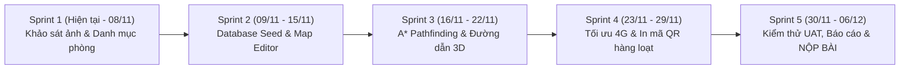

# HƯỚNG DẪN THIẾT LẬP 5 SPRINTS & IMPORT NHANH VÀO JIRA
**Dự án:** 3DMapUTH — Bản đồ Số 3D & Dẫn đường UTH  
**File dữ liệu import sẵn:** [`docs/jira_tasks_import.csv`](file:///c:/Users/DAT/OneDrive%20-%20ut.edu.vn/Documents/Desktop/3DMapUTH/docs/jira_tasks_import.csv)  
**Thời gian đếm ngược:** 5 tuần nữa đến hạn nộp bài / nghiệm thu khóa luận

---

## 📅 1. LỘ TRÌNH 5 TUẦN — 5 SPRINTS CHI TIẾT

| Sprint | Thời gian (1 tuần/Sprint) | Tên Sprint & Mục tiêu (Sprint Goal) | Deliverables chính |
| :---: | :---: | :--- | :--- |
| **Sprint 1** | **02/11 - 08/11/2026** *(Đến hết Chủ Nhật tuần này)* | **Asset Collection & Room Inventory** Thu thập ảnh thực tế 4 mặt, dựng concept 3D và lập danh mục toàn bộ phòng học CS1 & CS3. | - Bộ ảnh chụp thực tế. - File ảnh 3D $\ge 2\text{K}$ các khối nhà. - Bảng Excel/CSV danh mục phòng học theo tầng của 6 thành viên. |
| **Sprint 2** | **09/11 - 15/11/2026** | **Database Seeding & Map Editor** Số hóa dữ liệu vào PostgreSQL qua Prisma và hoàn thiện công cụ chỉnh sửa tọa độ đồ thị. | - Script `seed.ts` nạp 100% phòng CS1 & CS3. - Trang `/admin/map-editor` cho phép click thêm Waypoint/Edge trực tiếp trên 3D. |
| **Sprint 3** | **16/11 - 22/11/2026** | **Pathfinding Engine & Route Optimization** Thuật toán A* dẫn đường liên tòa nhà và xuyên tầng theo thời gian thực. | - Tuyến đường dẫn 3D phát sáng (Glow Path) mượt mà. - Chỉ đường chuyển tầng (thang bộ/thang máy) chuẩn xác. |
| **Sprint 4** | **23/11 - 29/11/2026** | **Mobile Optimization & QR Code Deployment** Tối ưu 4G, thêm màn hình tiến trình tải và công cụ xuất tem QR hàng loạt. | - Loading Screen hiển thị % tải mô hình. - File PDF tem QR gắn mã định vị phòng học sẵn sàng in ấn dán cửa. |
| **Sprint 5** | **30/11 - 06/12/2026** *(Tuần cuối - Hạn nộp)* | **UAT Testing, Documentation & Final Defense** Kiểm thử hiện trường thực tế, khắc phục lỗi, hoàn thiện báo cáo và slide bảo vệ. | - Báo cáo kỹ thuật đề tài hoàn chỉnh. - Video demo hệ thống. - Nghiệm thu / Nộp bài khóa luận. |

---

## ⚡ 2. HƯỚNG DẪN IMPORT FILE TASK VÀO JIRA TRONG 1 NỐT NHẠC

Dự án đã tạo sẵn file CSV chuẩn quốc tế: [`docs/jira_tasks_import.csv`](file:///c:/Users/DAT/OneDrive%20-%20ut.edu.vn/Documents/Desktop/3DMapUTH/docs/jira_tasks_import.csv) với đầy đủ Task, phân công người làm, Story Points và Sprint tương ứng.

### Các bước thực hiện:
1. Mở Jira của nhóm $\rightarrow$ Chọn Project **3DMapUTH** (Scrum Board).
2. Nhấn vào biểu tượng **`...`** (Tùy chọn) ở góc trên bên phải màn hình hoặc thanh menu bên trái $\rightarrow$ Chọn **Import issues from CSV** *(hoặc vào Settings ⚙️ $\rightarrow$ System $\rightarrow$ External System Import $\rightarrow$ CSV)*.
3. Nhấp **Browse** và chọn file:  
   `c:\Users\DAT\OneDrive - ut.edu.vn\Documents\Desktop\3DMapUTH\docs\jira_tasks_import.csv`
4. Tick chọn **Use an existing configuration file** nếu có, hoặc để mặc định rồi nhấn **Next**.
5. Chọn Project đích: Chọn đúng tên Project của nhóm (ví dụ: `3DMapUTH`).
6. **Khớp nối các cột (Field Mapping):**
   - `Issue Type` $\rightarrow$ chọn **Issue Type**
   - `Summary` $\rightarrow$ chọn **Summary**
   - `Description` $\rightarrow$ chọn **Description**
   - `Assignee` $\rightarrow$ chọn **Assignee**
   - `Priority` $\rightarrow$ chọn **Priority**
   - `Story Points` $\rightarrow$ chọn **Story Points** (hoặc *Story point estimate*)
   - `Sprint` $\rightarrow$ chọn **Sprint**
7. Nhấn **Next** $\rightarrow$ Kiểm tra lại thông tin $\rightarrow$ Nhấn **Begin Import**.
8. **Hoàn tất:** Toàn bộ 14 tasks lớn của 5 tuần sẽ tự động được tạo và phân bổ vào đúng Sprint và đúng thành viên!

---

## 🛠️ 3. HƯỚNG DẪN TẠO VÀ KÍCH HOẠT CÁC SPRINT TRÊN JIRA

Nếu trên Jira của bạn chưa có sẵn các Sprint, hãy tạo nhanh theo 4 bước sau:

### Bước 1: Vào trang Backlog
- Ở thanh menu bên trái dự án, click vào mục **Backlog**.

### Bước 2: Tạo lần lượt 5 Sprint
- Nhấn nút **Create sprint** (Nằm ở phía trên danh sách công việc).
- Nhấn 5 lần để tạo đủ 5 Sprint cho 5 tuần.

### Bước 3: Đặt tên và Cài đặt ngày cho từng Sprint
Click vào dấu **`...`** ở góc phải mỗi Sprint $\rightarrow$ chọn **Edit sprint**:

1. **Sprint 1:**
   - **Sprint name:** `Sprint 1 - Asset Collection & Room Inventory`
   - **Duration:** `1 week` (hoặc Custom)
   - **Start date:** `02/11/2026`
   - **End date:** `08/11/2026` (Chủ nhật tuần này)
   - **Sprint goal:** `Thu thập ảnh chụp thực tế, dựng concept 3D và hoàn thành bảng danh mục phòng học CS1 & CS3 của 6 thành viên.`

2. **Sprint 2:**
   - **Sprint name:** `Sprint 2 - Database Seeding & Map Editor`
   - **Duration:** `1 week`
   - **Start date:** `09/11/2026` | **End date:** `15/11/2026`
   - **Sprint goal:** `Seed 100% dữ liệu phòng học vào PostgreSQL Prisma & hoàn thiện chức năng chỉnh sửa Waypoints trên Map Editor.`

3. **Sprint 3:**
   - **Sprint name:** `Sprint 3 - Pathfinding Engine & Route Optimization`
   - **Duration:** `1 week`
   - **Start date:** `16/11/2026` | **End date:** `22/11/2026`
   - **Sprint goal:** `Hoàn thiện thuật toán tìm đường A* liên tòa nhà CS3 và xuyên tầng bằng thang bộ/thang máy.`

4. **Sprint 4:**
   - **Sprint name:** `Sprint 4 - Mobile Optimization & QR Code Deployment`
   - **Duration:** `1 week`
   - **Start date:** `23/11/2026` | **End date:** `29/11/2026`
   - **Sprint goal:** `Tối ưu tải 4G, thêm màn hình loading tiến trình và xuất file PDF tem mã QR dán cửa phòng.`

5. **Sprint 5:**
   - **Sprint name:** `Sprint 5 - UAT Testing & Final Defense`
   - **Duration:** `1 week`
   - **Start date:** `30/11/2026` | **End date:** `06/12/2026`
   - **Sprint goal:** `Kiểm thử thực địa tại CS1 & CS3, khắc phục toàn bộ bug, hoàn thiện báo cáo và slide bảo vệ nộp bài.`

### Bước 4: Kích hoạt Sprint 1 ngay lập tức
- Tại khung **Sprint 1 - Asset Collection & Room Inventory**, nhấn nút **Start sprint**.
- Chuyển sang tab **Active sprints / Board** để theo dõi trạng thái các task của Tài, Quân, Huy, Hoàng, Đạt, Hiếu di chuyển từ **To Do** $\rightarrow$ **In Progress** $\rightarrow$ **Done** trong tuần này!

