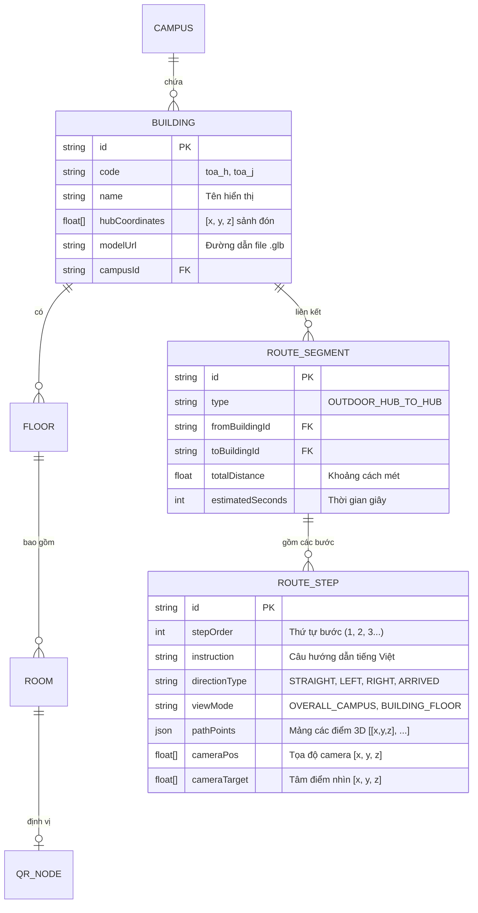
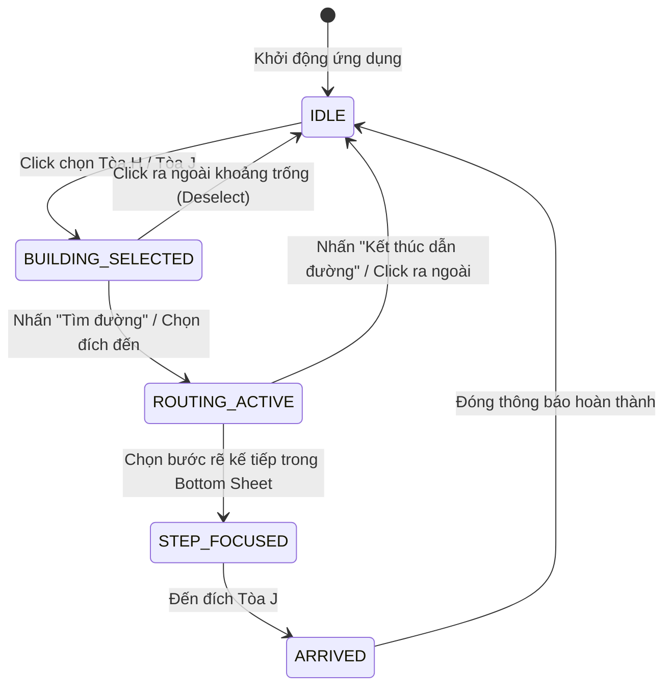

# Data Model: Tìm đường đi bộ từ Tòa H đến Tòa J (Cơ sở 3 UTH)

**Feature**: `001-find-route-toa-h-toa-j`  
**Phase**: Phase 1 (Design & Data Contracts)  
**Status**: Completed  

---

## 1. Phân cấp Thực thể Không gian (Spatial Hierarchy)

Tuân thủ nghiêm ngặt **Điều II** trong Hiến pháp Kỹ thuật 3DMapUTH:
$$\text{Campus} \longrightarrow \text{Building} \longrightarrow \text{Floor} \longrightarrow \text{Room} \longrightarrow \text{QrNode}$$



---

## 2. Chi tiết các Kiểu Dữ liệu TypeScript (TypeScript Interfaces)

```typescript
/**
 * Tọa độ 3D trong không gian Three.js
 */
export type Vector3Array = [number, number, number];

/**
 * Loại chỉ hướng di chuyển
 */
export type DirectionType = 'STRAIGHT' | 'LEFT' | 'RIGHT' | 'STAIRS_UP' | 'STAIRS_DOWN' | 'ARRIVED';

/**
 * Chế độ quan sát của Camera
 */
export type ViewMode = 'OVERALL_CAMPUS' | 'BUILDING_FLOOR';

/**
 * Tòa nhà trong khuôn viên
 */
export interface Building {
  id: string;
  code: string;
  name: string;
  campusId: string;
  hubCoordinates: Vector3Array;
  modelUrl?: string;
}

/**
 * Bước dẫn đường chi tiết
 */
export interface NavigationStep {
  id: string;
  stepOrder: number;
  stage: 'OUTDOOR' | 'INDOOR';
  instruction: string;
  directionType: DirectionType;
  viewMode: ViewMode;
  pathPoints: Vector3Array[];
  cameraPos: Vector3Array;
  cameraTarget: Vector3Array;
}

/**
 * Kết quả tính toán lộ trình hoàn chỉnh
 */
export interface NavigationRouteResult {
  originBuildingId: string;
  targetBuildingId: string;
  totalDistance: number;       // Tính bằng mét
  estimatedSeconds: number;    // Tính bằng giây
  fullPathPoints: Vector3Array[];
  steps: NavigationStep[];
}
```

---

## 3. Máy Trạng thái Dẫn đường (Navigation State Machine)

Quản lý tập trung trong Zustand Store (`useNavigationStore.ts`):



| Trạng thái | Mô tả hoạt động | Hành vi Camera 3D | Giao diện UI |
| :--- | :--- | :--- | :--- |
| `IDLE` | Người dùng đang quan sát tổng thể sa bàn CS3. | Góc nhìn toàn cảnh (Isometric Overview). | Chỉ hiện TopSearchBar. |
| `BUILDING_SELECTED` | Đang chọn Tòa H hoặc Tòa J. | Camera bay lại gần tòa nhà được chọn. | Hiện Tooltip 3D gắn trên nóc tòa. |
| `ROUTING_ACTIVE` | Đang vẽ đường dẫn đường nối Tòa H $\rightarrow$ Tòa J. | Camera bao quát trọn vẹn cung đường đi. | Hiện Bottom Sheet (75m, 1 phút). |
| `ARRIVED` | Đã đến sảnh đích Tòa J. | Camera tập trung vào sảnh chính Tòa J. | Hiện Badge chúc mừng và gợi ý xem tầng. |

---

## 4. Quy tắc Kiểm tra Hợp lệ (Validation Rules)

1. **Kiểm tra Tọa độ (Coordinates Validation):** Mọi tọa độ $Y$ của tuyến đường đi bộ ngoài trời bắt buộc nằm trong khoảng $[0.1, 0.3]$ (chuẩn là $0.2\text{m}$) để không chìm xuống mặt đường cũng không bay lơ lửng trên không.
2. **Kiểm tra Điểm xuất phát và Đích đến:**
   - Điểm xuất phát (`origin`) và điểm đến (`destination`) không được trùng nhau. Nếu trùng, hệ thống thông báo: *"Bạn đang ở ngay tại vị trí này"*.
3. **Tính liên tục của đường đi (Continuity):** Điểm kết thúc của `Step N` phải trùng với điểm bắt đầu của `Step N+1` để bảo đảm đường ống 3D không bị đứt đoạn.

