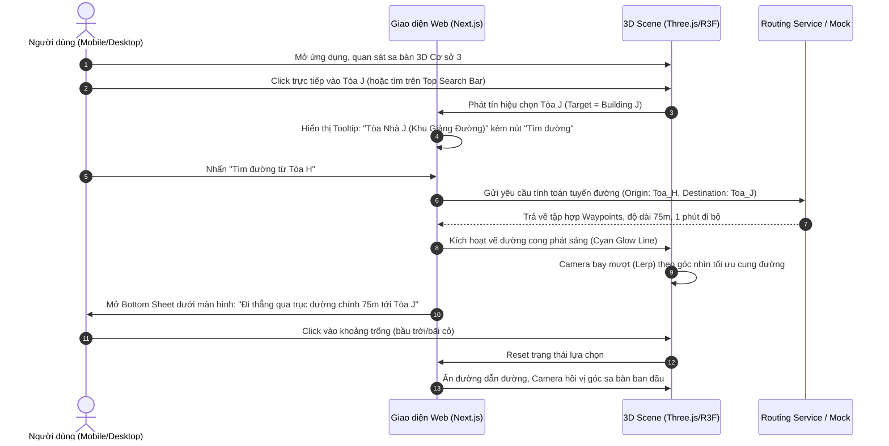

# Feature Specification: Tìm đường đi bộ từ Tòa H đến Tòa J (Cơ sở 3 UTH)

**Feature Branch**: `001-find-route-toa-h-toa-j`  
**Created**: 2026-11-06  
**Status**: Draft  
**Input**: Đặc tả tính năng tìm đường đi bộ liên tòa nhà giữa Tòa H (Trung tâm hành chính) và Tòa J (Khu giảng đường) tại khuôn viên Cơ sở 3 trường ĐH Giao thông vận tải TP.HCM.

---

## 1. User Scenarios & Testing *(mandatory)*

### User Story 1 - Tìm đường đi bộ từ Tòa H đến Tòa J trên Sa bàn 3D (Priority: P1)

**User Story:**  
> Là một **Sinh viên / Giảng viên / Khách tham quan** tại Cơ sở 3 UTH,  
> Tôi muốn **chọn điểm xuất phát tại Tòa H và điểm đến là Tòa J trên bản đồ số 3D**,  
> Để **nhìn thấy lộ trình đi bộ ngắn nhất, trực quan nhất qua các tuyến đường nội khu và dễ dàng di chuyển tới lớp học**.

**Why this priority:**  
Đây là tính năng cốt lõi (Core MVP) của hệ thống bản đồ số dẫn đường 3DMapUTH. Nếu không có tính năng tìm và hiển thị đường đi trực quan, hệ thống chỉ là một mô hình 3D tĩnh không mang lại giá trị dẫn đường thực tế.

**Independent Test:**  
Có thể kiểm thử độc lập bằng cách chọn Tòa H và Tòa J từ thanh tìm kiếm hoặc click trực tiếp trên mô hình 3D; hệ thống ngay lập tức tính toán và hiển thị tuyến đường đi bộ phát sáng màu Cyan (Glow Path) nối hai tòa nhà cùng bảng chỉ dẫn khoảng cách.

**Acceptance Scenarios (Gherkin Format):**

1. **Hiển thị lộ trình khi chọn đích đến:**
   - **Given** người dùng đang ở màn hình sa bàn 3D Cơ sở 3 với vị trí xuất phát mặc định là sảnh Tòa H,
   - **When** người dùng click vào khối mô hình 3D của Tòa J (hoặc chọn "Tòa J" từ thanh tìm kiếm),
   - **Then** hệ thống vẽ một đường line 3D phát sáng (Glow Path) uốn lượn theo vỉa hè/đường nội bộ nối từ sảnh Tòa H qua trục đường chính tới sảnh Tòa J,
   - **And** camera 3D tự động di chuyển (smooth lerp) nâng cao góc nhìn để bao quát trọn vẹn toàn bộ cung đường đi giữa hai tòa nhà,
   - **And** xuất hiện Bottom Sheet (trên Mobile) hoặc Side Panel (trên Desktop) hiển thị tổng khoảng cách (ví dụ: ~75m) và thời gian đi bộ ước tính (~1 phút).

2. **Cập nhật khi đổi điểm xuất phát hoặc điểm đến:**
   - **Given** hệ thống đang hiển thị lộ trình dẫn đường từ Tòa H đến Tòa J,
   - **When** người dùng click chọn một tòa nhà khác (ví dụ: Xưởng Ô tô) làm điểm đến mới,
   - **Then** tuyến đường cũ lập tức biến mất và tuyến đường mới từ Tòa H đến Xưởng Ô tô được vẽ lại tức thời trong $< 300\text{ms}$.

---

### User Story 2 - Tương tác trực quan 3D, Tooltip & Thao tác ngoài vùng (Priority: P2)

**User Story:**  
> Là một **Người dùng trải nghiệm bản đồ 3D**,  
> Tôi muốn **click vào tòa nhà để xem thông tin tóm tắt và click ra khoảng trống để hủy chọn**,  
> Để **dễ dàng khám phá khuôn viên trường mà không bị rối mắt bởi các bảng thông tin không cần thiết**.

**Why this priority:**  
Đảm bảo tính trực quan và khả năng tự phục hồi trạng thái giao diện (Clear State) theo tiêu chuẩn UX quốc tế.

**Independent Test:**  
Click vào tòa nhà $\rightarrow$ hiện Tooltip; Click vào mặt cỏ/khoảng trời trống $\rightarrow$ Tooltip đóng lại và camera trở về góc nhìn tổng thể (Overview Masterplan).

**Acceptance Scenarios (Gherkin Format):**

1. **Hiển thị Tooltip thông tin tòa nhà:**
   - **Given** người dùng đang quan sát sa bàn 3D,
   - **When** người dùng click hoặc chạm tay vào Tòa H hoặc Tòa J,
   - **Then** một thẻ Tooltip/Card nổi 3D (HTML Annotation) xuất hiện ngay trên đỉnh tòa nhà hiển thị: Tên tòa nhà, Mã hiệu, Số tầng, và Nút hành động nhanh "Dẫn đường đến đây".

2. **Hủy chọn khi click ra ngoài bản đồ (Deselection):**
   - **Given** một tòa nhà đang được chọn hoặc một tuyến đường đang hiển thị,
   - **When** người dùng click/chạm vào khoảng không gian trống (bầu trời, mặt cỏ không thuộc tòa nhà hoặc nút bấm "Xóa lộ trình"),
   - **Then** thẻ Tooltip và tuyến đường dẫn bị ẩn đi,
   - **And** Camera nhẹ nhàng quay trở về góc nhìn toàn cảnh sa bàn Cơ sở 3 (Isometric Overview).

---

### User Story 3 - Chuyển đổi tầng và Dẫn đường đa tầng trong nhà (Priority: P3)

**User Story:**  
> Là một **Sinh viên có lịch học tại phòng cụ thể ở Tòa J**,  
> Tôi muốn **khi đã tới Tòa J có thể mở bản đồ phân tầng để xem phòng học nằm ở tầng nào**,  
> Để **biết chính xác vị trí cầu thang và cửa phòng học mà không mất thời gian tìm kiếm**.

**Why this priority:**  
Hoàn thiện chặng 2 (Indoor Navigation) của hệ thống dẫn đường liên hoàn 2 chặng (Outdoor $\rightarrow$ Indoor).

**Independent Test:**  
Chọn Tòa J $\rightarrow$ bấm nút "Xem mặt bằng tầng" $\rightarrow$ chọn Tầng 1 / Tầng 2 / Tầng 3 trên bộ nút FloorSelector $\rightarrow$ mô hình hiển thị mặt cắt tầng tương ứng.

**Acceptance Scenarios (Gherkin Format):**

1. **Chuyển đổi tầng tại tòa nhà mục tiêu:**
   - **Given** người dùng đã được dẫn đường đến sảnh Tòa J,
   - **When** người dùng nhấn vào bộ chọn tầng `FloorSelector` và chọn "Tầng 2",
   - **Then** góc nhìn 3D chuyển từ phối cảnh toàn trường sang chế độ cắt lớp tầng (Floor Slice View) của Tòa J,
   - **And** lộ trình dẫn đường vẽ tiếp từ cửa sảnh $\rightarrow$ cầu thang bộ/thang máy $\rightarrow$ cửa phòng học mục tiêu tại Tầng 2.

---

## 2. Luồng trải nghiệm người dùng (User Journey)

---

## 3. Ngoại lệ & Xử lý Edge Cases (Edge Cases & Exception Handling)

1. **Mất kết nối mạng (Network Offline):**
   - *Tình huống:* Thiết bị di động của sinh viên mất sóng 4G/Wifi trong lúc di chuyển giữa các tòa nhà.
   - *Cách xử lý:* Hệ thống kích hoạt cơ chế **Offline Graceful Degradation**; toàn bộ thuật toán tìm đường và dữ liệu tọa độ waypoints Tòa H $\rightarrow$ Tòa J được nạp trực tiếp từ bộ đệm `mockNavigationData.ts` trên máy client. Người dùng vẫn xem được lộ trình 3D bình thường kèm thông báo nhẹ (Toast badge): *"Đang xem ở chế độ ngoại tuyến (Offline Mode)"*.

2. **Tọa độ phòng học hoặc tòa nhà không hợp lệ / không tìm thấy:**
   - *Tình huống:* Người dùng nhập một mã phòng chưa có trong cơ sở dữ liệu số hóa.
   - *Cách xử lý:* Hệ thống không để màn hình trắng hay báo lỗi kỹ thuật khó hiểu. Thay vào đó hiển thị thông báo thân thiện: *"Chưa có dữ liệu phòng học này. Hệ thống đã định vị sảnh chính tòa nhà gần nhất để bạn di chuyển"*, đồng thời ghim điểm đến về sảnh chính của tòa nhà.

3. **Thiết bị di động xoay màn hình ngang (Landscape Orientation):**
   - *Tình huống:* Người dùng xoay ngang điện thoại để xem bản đồ 3D góc rộng hơn.
   - *Cách xử lý:* Bottom Sheet ở đáy màn hình tự động chuyển đổi responsive thành bảng điều khiển nổi thu nhỏ (Floating Mini-Panel) ở góc phải màn hình, đảm bảo không che khuất góc nhìn 3D của đường đi.

4. **Người dùng liên tục click đổi điểm đến khi Camera đang di chuyển:**
   - *Tình huống:* Người dùng click liên tiếp vào Tòa J, Tòa H, Nhà Đa Năng trong khi hoạt ảnh camera chưa kết thúc.
   - *Cách xử lý:* Hệ thống áp dụng cơ chế **Debounce / Cancel Previous Transition**, hủy tween camera cũ và bắt đầu chuyển động mượt mà hướng về mục tiêu mới mà không giật khung hình.

---

## 4. Đặc tả Giao diện & Trải nghiệm (UI/UX Specifications)

1. **Canvas 3D tương tác (Interactive 3D Viewport):**
   - Chiếm $100\%$ không gian nền (Full viewport).
   - Hiển thị đầy đủ 5 mô hình CAD thực tế của Cơ sở 3: Tòa H, Tòa J, Nhà Đa Năng, Nhà I phụ trợ, Xưởng Ô tô.
   - Tuyến đường đi bộ được dựng bằng ống trụ/đường line cong phát sáng màu xanh Cyan rực rỡ (`#00f2fe`), có hiệu ứng dòng chảy ánh sáng (animated pulse/dash).
   - Cột mốc điểm đến (Destination Marker): Ghim cờ 3D màu đỏ cam nổi bật phía trên sảnh đón Tòa J.

2. **Thanh tìm kiếm trên cùng (Top Search Bar):**
   - Nằm cố định ở phía trên màn hình với hiệu ứng kính mờ (Glassmorphism, `backdrop-blur-md`).
   - Hỗ trợ gõ tìm kiếm nhanh "Tòa J", "Tòa H", hoặc chọn nhanh từ danh sách thả xuống.

3. **Thẻ thông tin tòa nhà (3D HTML Tooltip):**
   - Gắn neo (HTML Anchor) tại tọa độ không gian 3D của tòa nhà.
   - Hiển thị tên đầy đủ: "Tòa Nhà J (Khu Giảng Đường)", số tầng, và nút bấm CTA màu xanh UTH: `[ Chỉ đường tới đây ]`.

4. **Khung chỉ dẫn lộ trình (Step Bottom Sheet trên Mobile & Side Panel trên Desktop):**
   - *Trên Mobile:* Nằm ở đáy màn hình, có thể vuốt lên để xem chi tiết từng bước rẽ hoặc vuốt xuống để thu gọn.
   - *Nội dung hiển thị:*
     - Tổng quãng đường: $\mathbf{75\text{ m}}$
     - Thời gian đi bộ: $\mathbf{\approx 1\text{ phút}}$
     - Hướng dẫn từng bước: *"Từ sảnh Tòa H $\rightarrow$ Đi thẳng qua sân đường nội bộ $\rightarrow$ Rẽ nhẹ về hướng Tòa J $\rightarrow$ Đến sảnh chính Tòa J"*.
     - Nút đỏ: `[ Kết thúc dẫn đường ]`.

---

## 5. Yêu cầu Chức năng (Functional Requirements)

- **FR-001**: Hệ thống PHẢI cho phép người dùng chọn Tòa H làm điểm xuất phát và Tòa J làm điểm đến thông qua cả thao tác click trực tiếp trên Canvas 3D và thanh tìm kiếm.
- **FR-002**: Hệ thống PHẢI tự động tính toán tuyến đường đi bộ theo các nút giao thông (Waypoints) nội bộ thực tế, không để đường đi xuyên qua tường của các tòa nhà.
- **FR-003**: Hệ thống PHẢI render đường dẫn đường dưới dạng dải ánh sáng 3D (Glow Path) trên mặt đất với độ cao offset an toàn $+0.2\text{m}$ so với mặt đường để tránh hiện tượng nhấp nháy z-fighting.
- **FR-004**: Hệ thống PHẢI hỗ trợ điều khiển camera mượt mà (Pan/Orbit/Zoom) bằng chuột trên máy tính và cảm ứng 2 ngón trên điện thoại.
- **FR-005**: Hệ thống PHẢI hủy bỏ trạng thái chọn và ẩn tuyến đường khi người dùng click vào khoảng không trống trên Canvas.
- **FR-006**: Hệ thống PHẢI hiển thị bảng tóm tắt thời gian và cự ly di chuyển cho tuyến đường Tòa H $\rightarrow$ Tòa J.
- **FR-007**: Hệ thống PHẢI tự động chuyển sang dữ liệu nội bộ (Mock Data) khi mất kết nối mạng mà không làm gián đoạn trải nghiệm người dùng.
- **FR-008**: Hệ thống PHẢI đồng bộ trạng thái lộ trình vào Zustand Store toàn cục để các component UI và 3D Scene luôn phản ứng nhất quán.

---

## 6. Thực thể Dữ liệu Chính (Key Entities)

- **Building**: Đại diện cho khối nhà trong khuôn viên.
  - Thuộc tính: `id` (chuỗi), `code` ("toa_h", "toa_j"), `name` ("Tòa Nhà H", "Tòa Nhà J"), `campusId` ("campus_cs3"), `hubCoordinates` (mảng vector $[x, y, z]$ vị trí sảnh chính).
- **NavigationRoute**: Đại diện cho kết quả tìm đường.
  - Thuộc tính: `originBuildingId`, `targetBuildingId`, `totalDistance` (mét), `estimatedMinutes` (phút), `pathPoints` (danh sách tọa độ 3D tạo nên đường cong dẫn lối), `steps` (danh sách chỉ dẫn từng bước).
- **NavigationStep**: Từng bước hướng dẫn trên lộ trình.
  - Thuộc tính: `stepOrder` (thứ tự bước), `instruction` (câu lệnh hướng dẫn tiếng Việt), `directionType` (`STRAIGHT`, `LEFT`, `RIGHT`, `ARRIVED`), `cameraTarget` (tọa độ camera hướng về).

---

## 7. Tiêu chí Nghiệm thu Thành công (Success Criteria)

- **SC-001 (Tốc độ phản hồi):** Tuyến đường đi bộ Tòa H $\rightarrow$ Tòa J phải được vẽ hoàn tất trên màn hình trong vòng $< 300\text{ms}$ kể từ khi người dùng click chọn.
- **SC-002 (Độ mượt mà WebGL):** Hoạt cảnh camera bay theo cung đường phải duy trì tốc độ khung hình tối thiểu $\ge 30\text{ FPS}$ trên thiết bị di động tầm trung và $\ge 60\text{ FPS}$ trên máy tính.
- **SC-003 (Mức độ dễ hiểu UX):** $100\%$ người dùng tham gia thử nghiệm nội bộ có thể tìm thấy tuyến đường đi tới Tòa J trong lần thử đầu tiên mà không cần trợ giúp kỹ thuật.
- **SC-004 (Độ tin cậy):** Tính năng hoạt động ổn định đạt tỷ lệ thành công $100\%$ cả khi trực tuyến lẫn khi ngắt kết nối cơ sở dữ liệu (nhờ cơ chế Mock Fallback đã tích hợp).

---

## 8. Giả định & Ràng buộc Kỹ thuật (Assumptions & Constraints)

- Tuyến đường đi bộ giữa Tòa H và Tòa J tại Cơ sở 3 là đường bằng phẳng ngoài trời (Outdoor Pedestrian Path), người dùng không cần leo dốc hay vượt chướng ngại vật phức tạp.
- Vị trí sảnh chính Tòa H được quy ước tại tọa độ $(0, 0, 0)$ và Tòa J tại tọa độ $(-65, 0, -10)$ trên hệ quy chiếu Sa bàn 3D của dự án.
- Tuân thủ toàn diện **Hiến pháp Kỹ thuật 3DMapUTH (v1.0.0)**: Không viết raw SQL, bảo đảm kiểu dữ liệu TypeScript nghiêm ngặt, tách biệt hoàn toàn Canvas 3D khỏi UI 2D.

