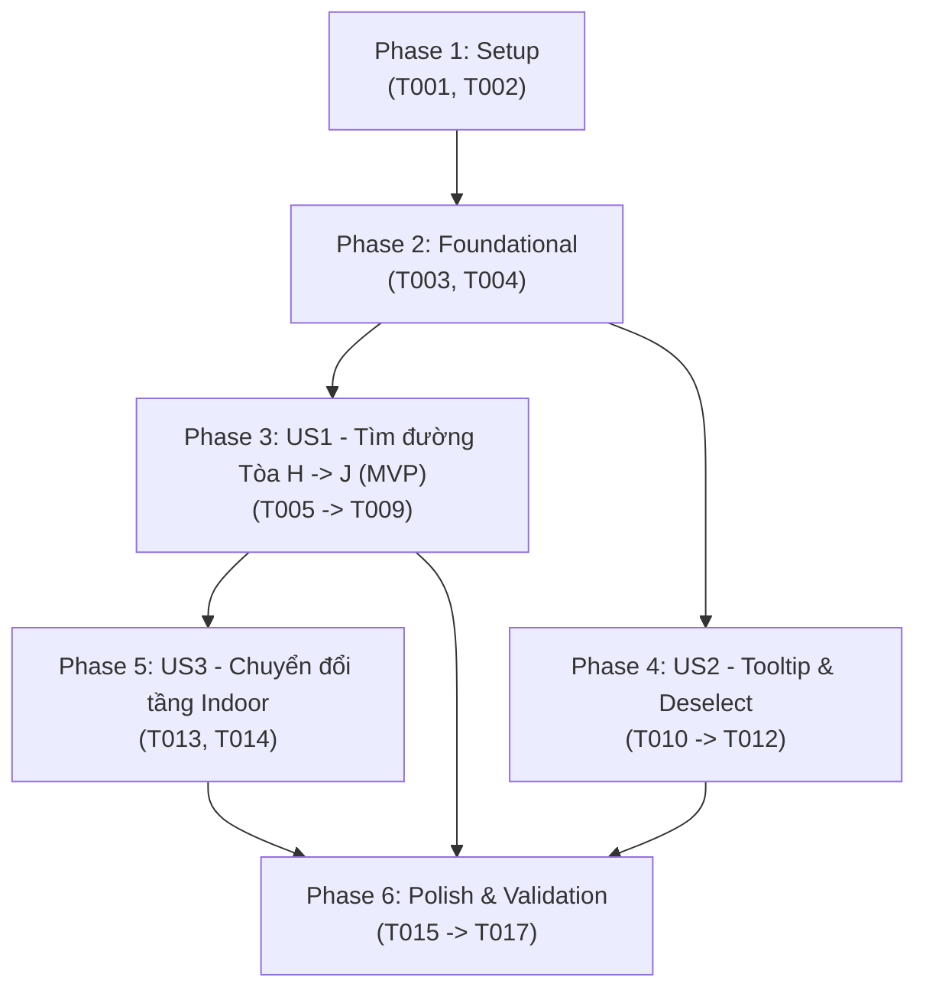

# Tasks: Tìm đường đi bộ từ Tòa H đến Tòa J (Cơ sở 3 UTH)

**Input**: Tài liệu thiết kế từ `specs/001-find-route-toa-h-toa-j/`  
**Prerequisites**: [plan.md](plan.md), [spec.md](spec.md), [research.md](research.md), [data-model.md](data-model.md), [contracts/route-api.json](contracts/route-api.json), [quickstart.md](quickstart.md)  
**Hiến pháp Kỹ thuật**: Tuân thủ nghiêm ngặt [constitution.md](../../constitution.md) (v1.0.0)

---

## Format: `[ID] [P?] [Story] Description`
- **[P]**: Có thể thực thi song song (khác file, không phụ thuộc nhau).
- **[Story]**: Gắn với User Story tương ứng (`[US1]`, `[US2]`, `[US3]`).
- Đường dẫn file rõ ràng, chính xác.

---

## Phase 1: Setup (Cấu trúc Kiểu dữ liệu & Tọa độ nền)

**Mục tiêu**: Chuẩn hóa kiểu dữ liệu TypeScript và tập tọa độ mốc không gian CS3.

- [x] T001 Cập nhật và bổ sung các interface kiểu dữ liệu điều hướng (`NavigationRouteResult`, `NavigationStep`, `DirectionType`, `ViewMode`) trong `src/types/navigation.ts` theo [data-model.md](data-model.md).
- [x] T002 [P] Khai báo tập tọa độ Waypoints chuẩn xác nối từ sảnh Tòa H $(0, 0, 0)$ qua trục đường chính tới sảnh Tòa J $(-65, 0, -10)$ với cao độ bù $+0.2\text{m}$ trong `src/data/mockNavigationData.ts`.

---

## Phase 2: Foundational (Hạ tầng State & API cốt lõi)

**Mục tiêu**: Xây dựng hạ tầng State Management và API định tuyến (Chặn mọi User Story cho đến khi hoàn thành).

- [x] T003 Mở rộng Zustand Store trong `src/store/useNavigationStore.ts` để lưu trữ `selectedBuilding`, `activeRoute`, `isNavigating`, `currentStepIndex` và các action `selectBuilding()`, `setRoute()`, `clearRoute()`.
- [x] T004 [P] Cập nhật Route Handler API trong `src/app/api/route-path/route.ts` hỗ trợ tính toán tuyến đường Tòa H $\rightarrow$ Tòa J theo chuẩn hợp đồng [contracts/route-api.json](contracts/route-api.json) với cơ chế Offline Fallback tự động.

**Checkpoint**: Nền tảng State và API sẵn sàng — Có thể bắt đầu triển khai các User Story độc lập.

---

## Phase 3: User Story 1 - Tìm đường đi bộ Tòa H đến Tòa J trên Sa bàn 3D (Priority: P1) 🎯 MVP

**Mục tiêu**: Dựng đường ống 3D phát sáng màu Cyan (Glow Path) nối Tòa H $\rightarrow$ Tòa J, tự động lia camera bao quát cung đường và mở Bottom Sheet cự ly 75m.  
**Independent Test**: Chọn Tòa J $\rightarrow$ Tuyến đường 3D xuất hiện ngay lập tức trong $< 300\text{ms}$ kèm Bottom Sheet hiển thị khoảng cách và thời gian đi bộ.

- [x] T005 [P] [US1] Tạo component `src/components/canvas/NavigationPath3D.tsx` sử dụng Three.js `CatmullRomCurve3` và `<tubeGeometry>` với vật liệu phát sáng `emissive="#00f2fe"` ($Y=0.2$).
- [x] T006 [P] [US1] Nâng cấp `src/components/canvas/CameraRig.tsx` tích hợp thuật toán nội suy `Vector3.lerp` và `MathUtils.damp` trong hook `useFrame` để bay mượt mà bao quát tuyến đường Tòa H $\rightarrow$ Tòa J.
- [x] T007 [US1] Nhúng component `NavigationPath3D` vào `src/components/canvas/CampusCS3Scene.tsx`, liên kết trực tiếp với `activeRoute` từ Zustand Store để bật/tắt đường dẫn.
- [x] T008 [US1] Cập nhật giao diện `src/components/ui/StepBottomSheet.tsx` để hiển thị: Tổng quãng đường 75m, Thời gian đi bộ ~1 phút, danh sách các bước rẽ và nút "Kết thúc dẫn đường".
- [x] T009 [US1] Tích hợp thanh tìm kiếm `src/components/ui/TopSearchBar.tsx` cho phép gõ tìm kiếm "Tòa J" hoặc chọn nhanh từ dropdown để kích hoạt tuyến đường.

**Checkpoint**: Hoàn tất User Story 1 — Hệ thống đạt chuẩn MVP dẫn đường 3D ngoài trời độc lập.

---

## Phase 4: User Story 2 - Tương tác trực quan 3D, Tooltip & Thao tác ngoài vùng (Priority: P2)

**Mục tiêu**: Hiển thị Tooltip khi click vào tòa nhà và tự động hủy chọn/reset camera khi click ra ngoài bãi cỏ/khoảng trời.  
**Independent Test**: Click Tòa J $\rightarrow$ hiện Tooltip; Click vào mặt cỏ trống $\rightarrow$ ẩn đường dẫn và đưa camera về góc sa bàn toàn cảnh.

- [x] T010 [P] [US2] Tạo component `src/components/canvas/BuildingTooltip.tsx` sử dụng `@react-three/drei` `<Html>` để hiển thị thẻ nổi 3D (tên tòa, số tầng, nút "Dẫn đường") neo trên nóc Tòa H và Tòa J.
- [x] T011 [US2] Bổ sung sự kiện tương tác `onClick`, `onPointerOver`, `onPointerOut` vào component `src/components/canvas/CADBuildingModel.tsx` để kích hoạt chọn tòa nhà.
- [x] T012 [US2] Thêm bộ bắt sự kiện click trên mặt nền đất/thảm cỏ trong `src/components/canvas/CampusCS3Scene.tsx` để kích hoạt `clearRoute()` và đưa camera hồi vị góc nhìn toàn cảnh (Isometric Overview).

**Checkpoint**: Hoàn tất User Story 2 — Trải nghiệm tương tác 3D đạt chuẩn quốc tế, tự phục hồi trạng thái sạch sẽ.

---

## Phase 5: User Story 3 - Chuyển đổi tầng và Dẫn đường đa tầng trong nhà (Priority: P3)

**Mục tiêu**: Hỗ trợ chuyển đổi tầng tại Tòa J để sinh viên xem sơ đồ phòng học sau khi đã đến nơi.  
**Independent Test**: Khi đến Tòa J $\rightarrow$ chọn Tầng 2 trên `FloorSelector` $\rightarrow$ góc nhìn chuyển sang mặt cắt tầng 2.

- [x] T013 [P] [US3] Cập nhật bộ nút chuyển tầng `src/components/ui/FloorSelector.tsx` hiển thị danh sách tầng của Tòa J khi trạng thái chuyển sang sảnh đến.
- [x] T014 [US3] Tích hợp logic chuyển đổi `viewMode` (`OVERALL_CAMPUS` $\longleftrightarrow$ `BUILDING_FLOOR`) trong `CampusCS3Scene.tsx` khi người dùng chọn một tầng cụ thể.

**Checkpoint**: Toàn bộ 3 User Stories hoàn tất và hoạt động độc lập hoặc liên hoàn mượt mà.

---

## Phase 6: Polish & Cross-Cutting Concerns

**Mục tiêu**: Tối ưu hóa hiệu năng, kiểm tra giao diện mobile và xác thực chất lượng trước khi release.

- [x] T015 [P] Kiểm tra độ tương thích responsive trên Mobile (cả chế độ dọc Portrait và ngang Landscape) cho `StepBottomSheet.tsx`.
- [x] T016 Kiểm tra an toàn kiểu dữ liệu toàn dự án bằng lệnh `npx tsc --noEmit` đạt 0 lỗi biên dịch.
- [x] T017 Thực hiện toàn bộ 4 kịch bản kiểm thử trong `specs/001-find-route-toa-h-toa-j/quickstart.md` (chọn Tòa J, click ra ngoài, ngắt mạng offline và test API endpoint).

---

## Dependencies & Execution Order

### Chiến lược Triển khai Song song (Parallel Opportunities):
- **Giai đoạn Setup & Foundational:** T001, T002 và T004 có thể triển khai song song vì tác động trên các file khác nhau (`types/navigation.ts`, `data/mockNavigationData.ts`, `api/route-path/route.ts`).
- **Giai đoạn US1 (MVP):** 
  - Lập trình viên A: Dựng component đồ họa `NavigationPath3D.tsx` (T005) & CameraRig (T006).
  - Lập trình viên B: Xây dựng UI `StepBottomSheet.tsx` (T008) & `TopSearchBar.tsx` (T009).
  - Tích hợp vào `CampusCS3Scene.tsx` (T007) hoàn tất MVP chỉ sau 1 phiên làm việc!

